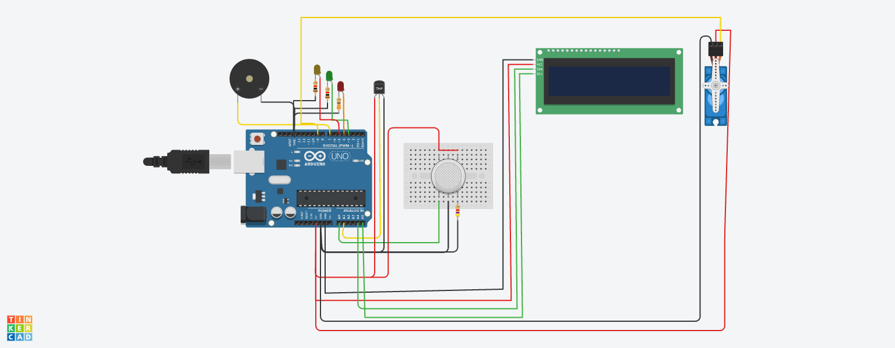

# 🔥 Smart Fire & Gas Safety System

An Arduino-based intelligent fire and gas leakage detection system with automated alerts and servo-controlled ventilation, simulated using **Tinkercad Circuits**.

## 📌 Overview

This project uses an **MQ-2 gas sensor** and a **TMP36 temperature sensor** to continuously monitor environmental conditions and identify potential gas leakage and fire hazards.

Based on sensor readings, the Arduino automatically activates visual indicators, audio alarms, an LCD display, and a servo-controlled ventilation mechanism.

## ✨ Key Features

- **Dual Sensor Monitoring:** Real-time gas/smoke and temperature detection.
- **3-Level Indicators:** Green (Safe), Yellow (Warning), and Red (Danger).
- **Smart Audio Alerts:** 400 Hz gas leakage alarm and 800/500 Hz fire siren.
- **Automated Ventilation:** Servo-controlled positioning at 0°, 45°, and 90°.
- **I2C LCD Display:** Displays live sensor readings and system status.
- **False Alarm Reduction:** High temperature alone does not trigger the buzzer.

## 🛠️ Hardware Components

| Component | Arduino Pin |
|---|---|
| Arduino Uno R3 | Main Controller |
| MQ-2 Gas Sensor | A0 |
| TMP36 Temperature Sensor | A1 |
| 16×2 I2C LCD | A4 (SDA), A5 (SCL) |
| Green LED | D3 |
| Red LED | D4 |
| Yellow LED | D5 |
| Piezo Buzzer | D7 |
| Micro Servo Motor | D9 |

**LCD I2C Address:** `0x20`

## 🚦 Operating Conditions

| System State | Detection Condition | Response |
|---|---|---|
| 🟢 Safe | Gas < 350, Temp < 38°C | Green LED, Servo 0° |
| 🟡 Warning | Gas 350–499 or Temp 38–49°C | Yellow LED, Servo 45° |
| 🔴 High Temp | Temp ≥ 50°C, Gas < 500 | Red LED, Silent, Servo 90° |
| 🔴 Gas Leak | Gas ≥ 500, Temp < 50°C | 400 Hz Alarm, Servo 90° |
| 🚨 Fire Alert | Gas ≥ 500, Temp ≥ 50°C | Dual-Tone Siren, Servo 90° |

## ⚙️ Technologies Used

- Arduino Uno R3
- Arduino C/C++
- MQ-2 Gas Sensor
- TMP36 Temperature Sensor
- I2C LCD
- Servo Motor
- Tinkercad Circuits

## 🔄 Working Principle

1. Sensors continuously collect gas and temperature data.
2. Arduino processes the analog readings.
3. A condition-based algorithm identifies the hazard level.
4. LEDs and buzzer provide appropriate alerts.
5. The servo automatically adjusts the ventilation position.
6. LCD displays real-time readings and system status.

## 🖥️ Circuit Diagram

## 🔗 Tinkercad Simulation

[View Project on Tinkercad](ADD_YOUR_TINKERCAD_LINK_HERE)

## 🚀 Future Improvements

- IoT-based remote monitoring.
- GSM-based emergency SMS notifications.
- Mobile application integration.
- Cloud-based sensor data logging.
- Advanced sensor calibration and fault detection.

## ⚠️ Safety Note

This project is an educational prototype simulated in Tinkercad. It is not a certified fire or gas safety system and should not be used as a replacement for professional safety equipment.

## 👨‍💻 Project Details

**Project:** Smart Fire & Gas Safety System  
**Platform:** Arduino Uno R3  
**Simulation:** Tinkercad Circuits  
**Category:** Embedded Systems | Automation | Safety Engineering

---

**Detect Hazards. Generate Alerts. Automate Response.**
